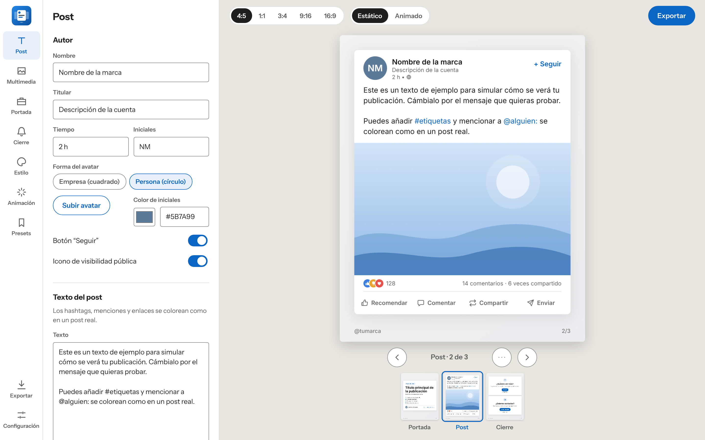
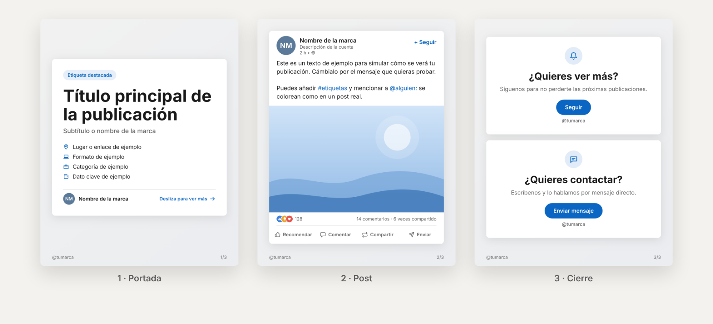
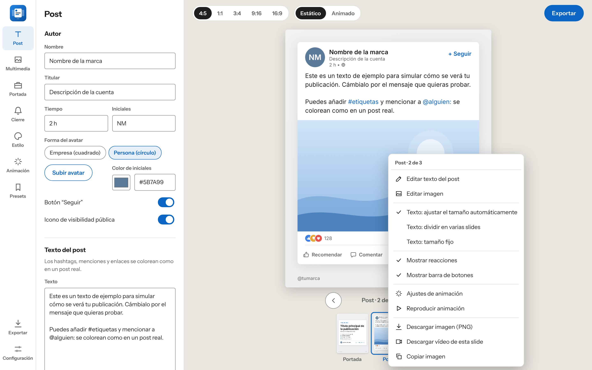
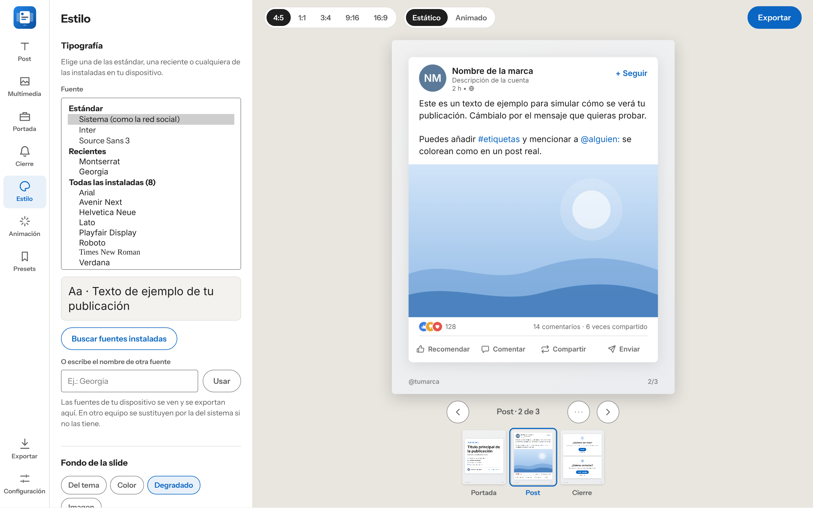
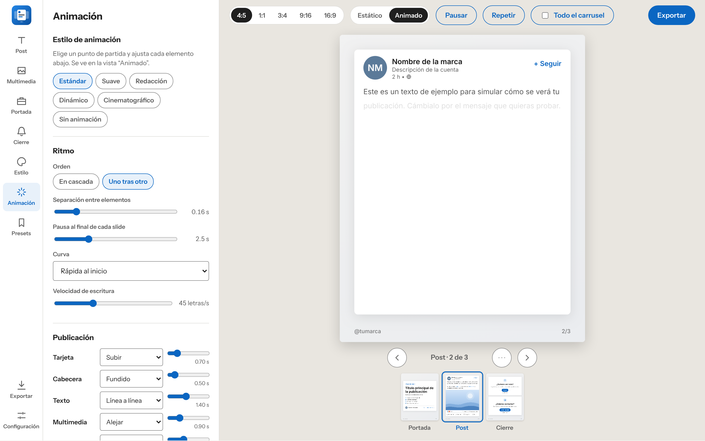
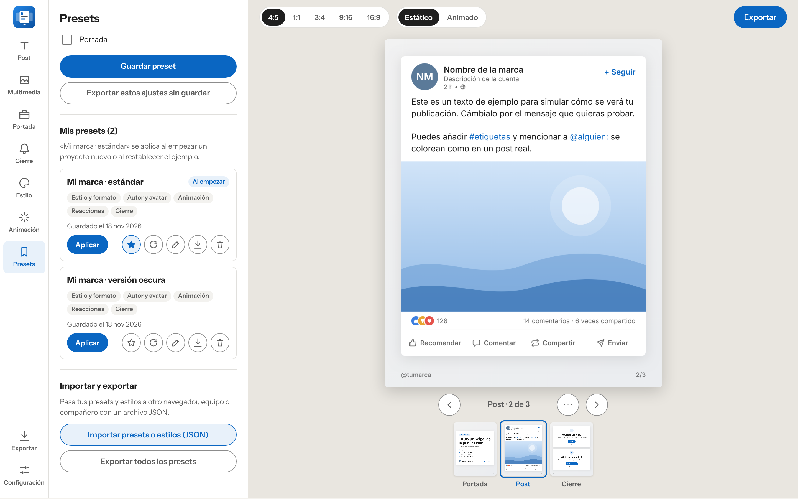
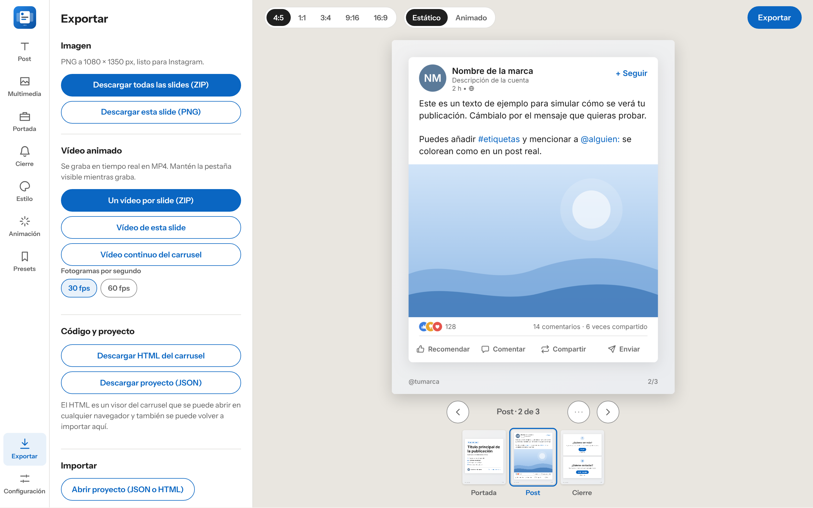
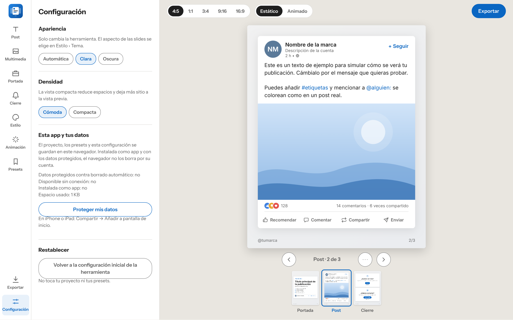
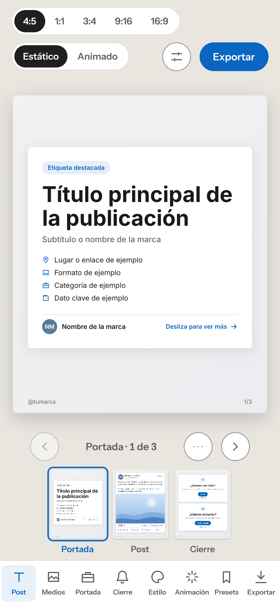
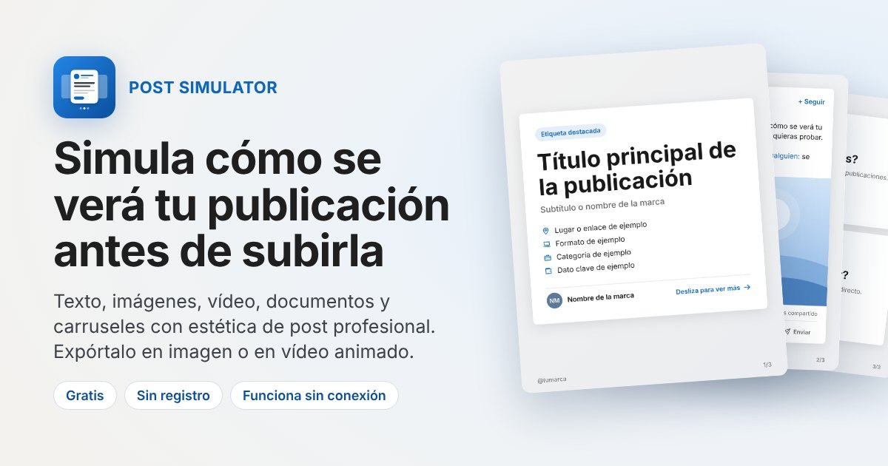

<div align="center">


# Post Simulator

**Simula cómo se verá tu publicación antes de subirla.**

Texto, imágenes, vídeo, documentos y carruseles con la estética de un post profesional. Pruébalo en pantalla y expórtalo en imagen o en vídeo animado, listo para publicar.

[**Abrir la herramienta →**](https://luckstudio.github.io/post-simulator/)

Gratis · Sin registro · Funciona sin conexión · Se instala como app

<br>



</div>

<br>

## Así queda

Un carrusel de ejemplo (portada, publicación con imagen y cierre) en formato 4:5 (1080 × 1350 px), el que más espacio ocupa en el feed de Instagram. Todo el contenido es de relleno: cámbialo por el tuyo.



<br>

## Cómo se usa

1. **Escribe tu publicación.** Nombre de la cuenta, texto y una imagen, un vídeo o un documento. Si quieres un carrusel, añade una portada y un cierre.
2. **Dale tu estilo.** Avatar, colores, tipografía, fondo y animación… o aplica un preset guardado con un clic.
3. **Exporta.** Descarga las imágenes en un ZIP o un vídeo animado y súbelo a Instagram.

<br>

## Todo lo que puedes hacer

<table>
  <tr>
    <td width="50%" valign="top">
      <h3>✍️ El texto se coloca solo</h3>
      <p>Si el post es largo, la herramienta busca el tamaño de letra que cabe en una slide. También puedes repartirlo en varias slides o fijar el tamaño con “… más”. Los hashtags, menciones y enlaces se colorean como en un post real.</p>
    </td>
    <td width="50%" valign="top">
      <h3>🖱️ Todo a un clic derecho</h3>
      <p>En la tira de slides: editar esa slide, ocultar o volver a mostrar la portada y el cierre, cambiar cómo se ajusta el texto, reproducir la animación, descargarla o copiarla como imagen.</p>
    </td>
  </tr>
  <tr>
    <td colspan="2" align="center"></td>
  </tr>
  <tr>
    <td width="50%" valign="top">
      <h3>🔤 Cualquier tipografía</h3>
      <p>Las estándar, las que has usado hace poco y todas las que tienes instaladas en tu equipo. Si no aparece, escribe su nombre.</p>
      
    </td>
    <td width="50%" valign="top">
      <h3>🎬 Animado, a tu ritmo</h3>
      <p>Seis estilos de animación y dieciséis efectos por elemento. Decide cuánto dura cada slide y, si lleva vídeo, si se ve completo, más o menos tiempo.</p>
      
    </td>
  </tr>
  <tr>
    <td width="50%" valign="top">
      <h3>🔖 Presets: tu marca en un clic</h3>
      <p>Guarda estilo, autor, animación, reacciones y cierre con un nombre, y aplícalos a la siguiente publicación. Marca uno para que sea tu punto de partida y pásaselos a tu equipo como archivo.</p>
      
    </td>
    <td width="50%" valign="top">
      <h3>📦 Exporta como quieras</h3>
      <p>Imágenes PNG (una o todas en ZIP), vídeo MP4 o WebM (por slide o continuo con transiciones), un HTML para enseñar el carrusel en el navegador y el proyecto en JSON para seguir otro día.</p>
      
    </td>
  </tr>
  <tr>
    <td width="50%" valign="top">
      <h3>⚙️ A tu gusto</h3>
      <p>Interfaz clara, oscura o automática (como tu dispositivo) y una vista compacta que deja más sitio a la vista previa. Preparada para añadir más formas de verla.</p>
      
    </td>
    <td width="50%" valign="top" align="center">
      <h3>📱 También en el móvil</h3>
      <p align="left">Se instala como una app y funciona sin conexión. Tus proyectos y presets se quedan en tu dispositivo.</p>
      
    </td>
  </tr>
</table>

<br>

## Instálala como app

- **Chrome o Edge (ordenador o Android):** botón _Instalar_ en la barra de direcciones, o _Configuración › Instalar como app_ dentro de la herramienta.
- **iPhone o iPad (Safari):** _Compartir › Añadir a pantalla de inicio_.

Una vez instalada se abre en su propia ventana y funciona aunque no tengas conexión.

## Tus datos son tuyos

No hay cuentas ni servidores. El proyecto, los presets y la configuración se guardan **en tu navegador**. Para no perderlos:

- En _Configuración › Esta app y tus datos_ pulsa **Proteger mis datos**, para que el navegador no los borre por su cuenta.
- Exporta tus presets y proyectos como JSON de vez en cuando: sirven de copia de seguridad y para pasarlos a otro equipo.

## Compártela

Envía el enlace **https://luckstudio.github.io/post-simulator/**. En WhatsApp, Telegram, LinkedIn, Slack o iMessage aparece con su vista previa:



<br>

---

<details>
<summary><strong>Para desarrolladores</strong></summary>

<br>

El brief, las decisiones y las limitaciones están en [`docs/CONTEXTO.md`](docs/CONTEXTO.md). La arquitectura, en [`docs/ARCHITECTURE.md`](docs/ARCHITECTURE.md).

### Puesta en marcha

Requisitos: Node 20 o superior.

```bash
npm install
```

```bash
npm run dev
```

```bash
npm test
```

```bash
npm run lint
```

### Build y publicación

```bash
npm run build
```

Genera **`dist/index.html`**, un único archivo con todo dentro (JS, CSS y JSZip), y copia `dist/` a la **raíz** del repositorio: `index.html`, `manifest.webmanifest`, `sw.js`, `icons/`, `screenshots/`, `og-image.jpg`… GitHub Pages sirve la rama `main` tal cual, así que **tras cambiar algo hay que ejecutar `npm run build` y subir también esos archivos**. La fuente del HTML es `src/index.html` y la de los demás, `src/public/`.

### Imágenes (necesitan Playwright con Chromium)

```bash
node scripts/make-icons.mjs
```

Iconos de la app a partir del diseño definido en el propio script: SVG, PWA, iPhone y favicon.

```bash
npm run build && node scripts/make-screenshots.mjs && npm run build
```

Capturas del README (`docs/img/`), capturas del manifiesto y la imagen para compartir (`og-image.jpg`), en modo claro y a partir de la build real.

```bash
npm run build && npm run check:legacy
```

Comprueba píxel a píxel que el dibujo de las slides no ha cambiado respecto a la versión original.

### Estructura

```
index.html, sw.js, manifest.webmanifest, icons/, …   build publicada (no editar a mano)
src/
  index.html          HTML de desarrollo (incluye las etiquetas para compartir)
  main.js · app.js    entrada y composición
  core/               constantes, utilidades, ajustes de la interfaz, tipografías
  state/              esquema, store, migraciones, presets, preferencias
  animation/          curvas, presets de animación y línea de tiempo
  render/             maquetado y dibujo en canvas (slides en render/slides/)
  io/ · export/       archivos, imágenes, PDF, fuentes · PNG/ZIP, vídeo, HTML, JSON
  ui/                 vista previa, menú contextual, apariencia y pestañas del panel
  public/             PWA, iconos, capturas e imagen para compartir (se copian tal cual)
  pwa.js              service worker, instalación y almacenamiento persistente
tests/                tests unitarios (Vitest)
scripts/              publicación, iconos, capturas y comparación con el original
docs/                 contexto, arquitectura e imágenes del README
legacy/               versión original de un solo archivo, como referencia
```

</details>
